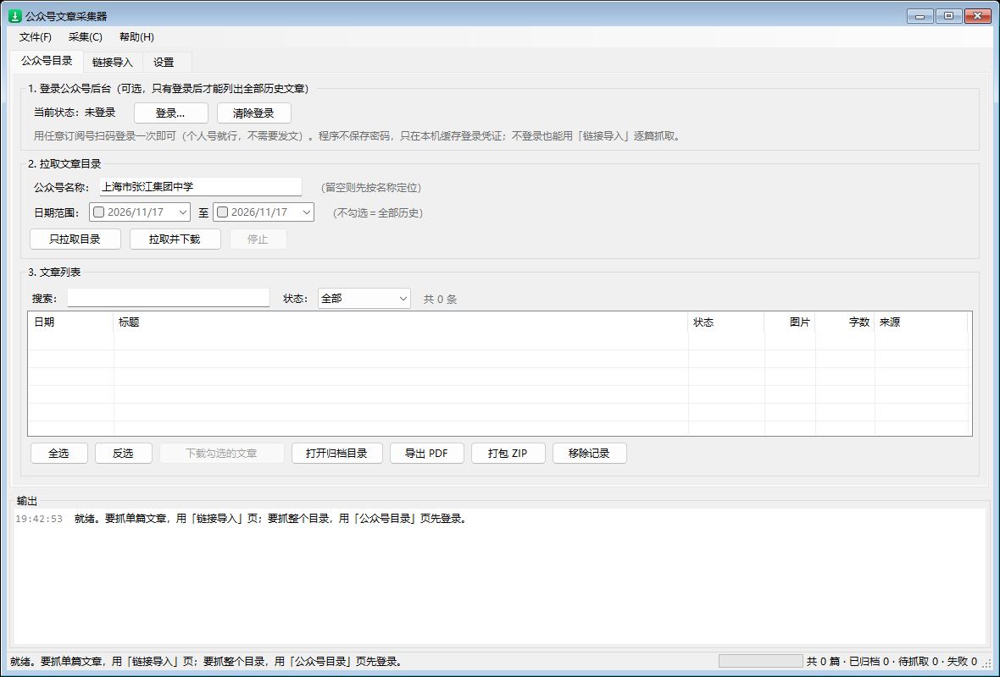
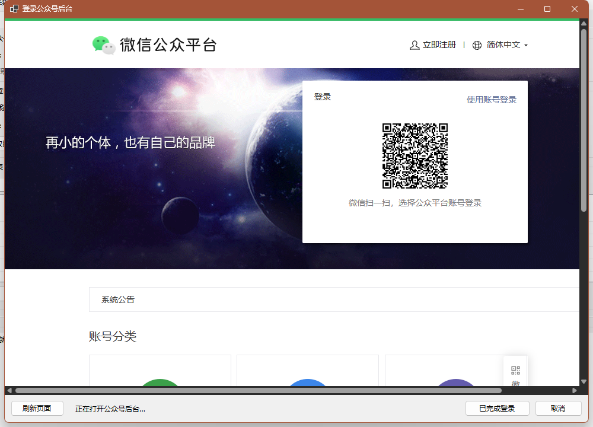
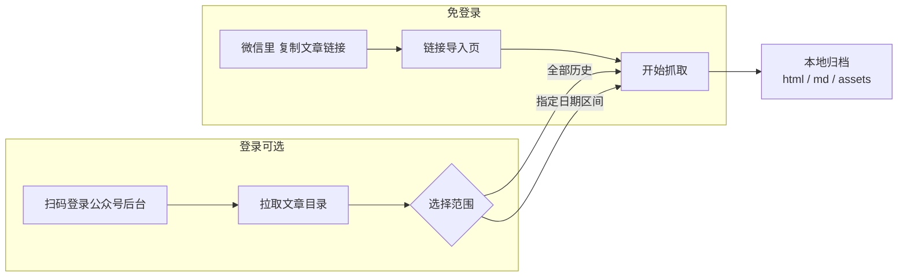

# 公众号文章采集器 · WeChat MP Archiver

把微信公众号的文章与资源归档到本地的 Windows 桌面小工具。正文排版、图片、语音全部落地，
生成可以离线打开的 HTML 与 Markdown。界面使用 WinForms 系统原生控件，没有自绘皮肤。

> 起因：孩子学校公众号的文章想留个底，微信官方又没有导出功能，于是自己写了一个。

## 下载即用

到 [Releases](https://github.com/zfy273/wechat-mp-archiver/releases) 下载
`WeChatMPArchiver-v3.0.0-win-x64.exe`，双击就能跑——**已内置 .NET 运行时，不用装任何环境**
（约 65 MB，首次启动会自解压，慢一两秒属正常）。

> 唯一的外部依赖是系统自带的 WebView2 运行时：Windows 11 和装了 Edge 的 Windows 10 都有。
> 没有也能用「链接导入」抓单篇，只是「登录公众号后台」和「导出 PDF」两个功能不可用。

## 界面

主界面（WinForms 系统原生控件，没有自绘皮肤）：



登录窗（可选，用 WebView2 承载微信扫码页）：



## 目录

- [下载即用](#下载即用)
- [界面](#界面)
- [功能](#功能)
- [两种采集方式](#两种采集方式)
- [为什么免登录拿不到文章列表](#为什么免登录拿不到文章列表)
- [环境要求](#环境要求)
- [构建与运行](#构建与运行)
- [使用步骤](#使用步骤)
- [归档产物](#归档产物)
- [项目结构](#项目结构)
- [已知限制](#已知限制)
- [免责声明](#免责声明)

## 功能

- **免登录也能用**：把文章链接粘进来就能抓，自动从一段文字/聊天记录里挑出链接、去重、规范化
- **登录后列目录**：扫码登录一次公众号后台，翻出该号全部历史文章（标题、日期、状态）
- **按日期一键爬**：勾选起止日期点「拉取并下载」，只抓这段时间；不勾就是全部历史
- **离线可读**：每篇一个文件夹，`index.html` 里图片已本地化，断网也能看
- **资源齐全**：正文图片、语音消息（mp3）、封面；视频保留原链接
- **整理方便**：按标题/摘要/正文搜索，导出 PDF，打包 ZIP，双击打开离线页

## 两种采集方式



| 通道 | 需要登录 | 能拿到什么 | 适用场景 |
| --- | --- | --- | --- |
| 链接导入 | 否 | 你手上已有的那几篇 | 存几篇特定的文章 |
| 公众号目录 | 是（任意订阅号，扫码即可） | 该号全部历史文章的**列表** | 整站归档 / 按时间段批量抓取 |

## 为什么免登录拿不到文章列表

微信没有开放「列出某公众号全部文章」的公开接口。以下入口都实测过：

| 探测的入口 | 返回 |
| --- | --- |
| `mp/profile_ext?action=home&__biz=…`（文章页底部「查看历史消息」的网页版） | `请在微信客户端打开链接` |
| `mp/profile_ext?action=getmsg`（伪造 uin/key，桌面 UA 与 MicroMessenger UA 都试） | `{"ret":-3,"errmsg":"no session"}` |
| `mp/appmsgalbum?action=getalbumlist`（合集） | `{"ret":-3}`，同样需要会话 |
| 文章页里的「往期推荐 / 同号内链」 | 每篇只含它自己 1 个 mid，无法顺着一篇扩散 |
| 搜狗微信文章的跳转链接 | 解析出 `src=11&signature=…` 后直接请求，被导向「环境异常」验证页 |

所以「列目录」这一步只能用登录态换。程序用的是后台图文编辑器里「超链接 → 选择其他公众号」
所用的两个接口（`searchbiz` / `appmsg`），这也是市面上同类工具的共同原理。

## 环境要求

- **直接用 Release 版**：Windows 10 / 11 即可，运行时已打包进 exe，无需安装 .NET
- **自行编译**：需要 [.NET 6 SDK](https://dotnet.microsoft.com/download/dotnet/6.0)
- WebView2 Runtime（仅「登录」与「导出 PDF」需要；Win11 自带，Win10 一般随 Edge 安装）

## 构建与运行

```bash
git clone https://github.com/zfy273/wechat-mp-archiver.git
cd wechat-mp-archiver/src/WeChatHarvester
dotnet build -c Release
dotnet run
```

发布成可直接双击的目录：

```bash
dotnet publish -c Release -r win-x64 --self-contained false -o ../../publish
```

> `app.ico` 是可选的：没有图标文件也能编译，只是用系统默认图标。

## 使用步骤

详细说明见 [docs/使用说明.md](docs/使用说明.md)。三步概要：

1. **要整份目录**：`公众号目录` 页 → `登录…` → 扫码 → `拉取文章目录`（可勾选日期范围）
2. **只想存某几篇**：`链接导入` 页 → `粘贴剪贴板` → `开始抓取`
3. 抓完在列表里双击一行，直接用浏览器打开离线页面

命令行单篇抓取（适合写脚本）：

```bash
张江公众号采集器.exe --fetch "https://mp.weixin.qq.com/s?__biz=...&mid=...&idx=1&sn=...&chksm=..."
```

## 归档产物

```
<归档目录>/<公众号名>/
├─ index.json                     # 全部记录（含正文摘要，用于搜索）
└─ articles/
   └─ 2025-11-07_安全教育…_a1b2c3/
      ├─ index.html               # 离线阅读页，图片全在本地
      ├─ article.md               # Markdown，可导入 Obsidian / 语雀
      ├─ meta.json                # 标题 / 作者 / 时间 / 原文链接 / 图片数 / 字数
      └─ assets/                  # img_xxx.jpg、voice_xxx.mp3
```

## 项目结构

```
src/WeChatHarvester/
├─ Program.cs                     # 入口（含 --fetch 命令行模式）
├─ Forms/
│  ├─ MainForm.cs                 # 主窗口：目录 / 链接导入 / 设置 三个选项卡
│  └─ LoginForm.cs                # 登录窗（WebView2 承载扫码页）
├─ Models/Models.cs               # 文章记录、设置项
└─ Services/
   ├─ MpSession.cs                # 公众号后台接口（searchbiz / appmsg 翻页）
   ├─ ArticleDownloader.cs        # 正文解析 + 图片/语音下载 + 离线页生成
   ├─ HtmlToMarkdown.cs           # DOM → Markdown
   ├─ Library.cs                  # index.json 索引与去重
   ├─ LinkParser.cs               # 从任意文本里抽链接并规范化
   └─ PdfExporter.cs              # 用 WebView2 的 PrintToPdf 导出 PDF
```

## 已知限制

- **列目录必须登录**：见上文实测表
- **视频不能离线**：公众号视频是加密分片，只保留原链接
- **会触发限流**：连续翻十几页后微信可能返回「操作过于频繁」，程序会自动等待重试；
  仍失败则完成一次安全验证后继续，已拉到的部分不会重拉
- **只支持图文**：`type=9` 的文章；视频号内容不在目录里

## 免责声明

本项目仅用于个人学习、家校留档等合理用途。归档内容的版权归原公众号及作者所有，
请勿用于商业传播或二次发布。抓取频率内置随机延迟，请勿调至 1 秒以内。
